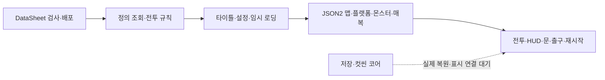
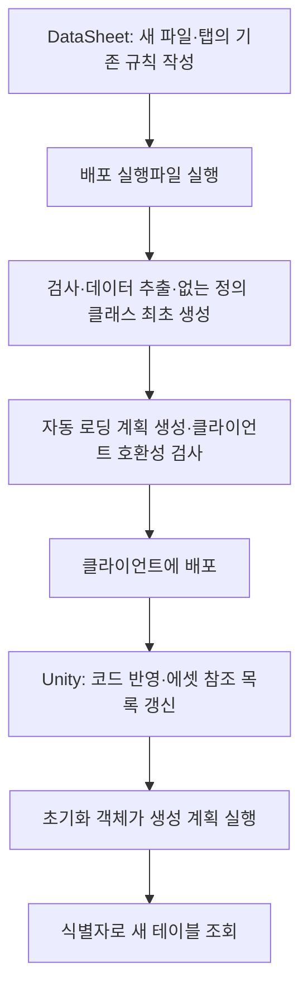
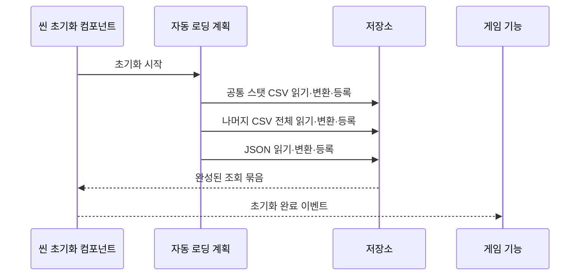

# Human_Ghost-

2026-11-05 오류 팝업: TitleScreen 프리팹과 MapDohwagolTest에 자동 수집·입력 차단·독립 일시정지를 연결했습니다. 새 씬의 Inspector 설정과 확인 순서는 [기획자 안내](Docs/기획자용%20에러%20팝업%20사용%20안내.md)를 참고합니다. 데이터911·코어604·기존 CS0414 제외 개발 분기 참조 컴파일 통과, 실제 Unity 표시 검증은 별도입니다.

2026-11-04 최신 풀 `c7100e3`: JSON2 맵·몬스터·매복, 타이틀/설정·임시 로딩·전투 화면과 회의 버그 수정이 테스트 씬에 연결돼 있습니다. 저장 실제 복원·컷씬 표시·정식 장부방·풀링·최종 아트는 후속입니다. 데이터875·코어600 통과, 엄격한 엔진 참조 컴파일은 `_exitAnchor` 미사용으로 실패했습니다. [현재 구현과 검증 현황](Docs/현재%20구현과%20검증%20현황.md), [남은 작업과 회의 반영](Docs/남은%20구현과%20검증%20작업.md), [기획 대조](Docs/기획%20완료%20기준%20점검표.md)를 기준으로 사용합니다.

싱글플레이 2D 액션게임 클라이언트입니다. 데이터는 형제 프로젝트인 DataSheet에서 검사·배포하고, 클라이언트는 읽기·객체 변환·조회·게임 기능 연결을 담당합니다.

디스코드 머지 알림 설정과 연결 테스트는 [알림 가이드](Docs/%EB%94%94%EC%8A%A4%EC%BD%94%EB%93%9C%20%EC%95%8C%EB%A6%BC%20%EC%84%A4%EC%A0%95%20%EC%95%88%EB%82%B4.md)를 참고합니다.

## 먼저 볼 문서

Windows 게임 빌드를 버튼으로 시작하고 빌드 전용 채널에서 결과를 받는 방법은
[GitHub 빌드와 디스코드 공지 사용 안내](Docs/GitHub%20빌드와%20디스코드%20공지%20사용%20안내.md)를 참고합니다.
현재는 수동 시작 후 검사·개발 빌드·결과물7일 보관·공지가 자동 진행됩니다. 특정 커밋 입력과 매 푸시 게임 빌드는 아직 구성하지 않았습니다.

| 문서 | 내용 |
| --- | --- |
| [공용 에러 팝업 설계](Docs/공용%20에러%20팝업%20설계.md) | 표시·자동 오류 수집·공용 버튼·수명·한국어/영어 연결 계약 |
| [기획자용 에러 팝업 사용 안내](Docs/기획자용%20에러%20팝업%20사용%20안내.md) | 초보자용 씬 배치·개발자 연결 요청·외형/공용 버튼 편집·동작 확인·문제 해결 |
| [전투와 탐색 아이디어 검토안](Docs/전투와%20탐색%20아이디어%20검토안.md) | 열한 아이디어의 의도·장르 정합성·탐색/재방문 연결·책임·검증 순서 제안 |
| [맵 구성과 몬스터 배치 데이터 제안서](../DataSheet/Docs/맵%20구성과%20몬스터%20배치%20데이터%20제안서.md) | 플랫폼 JSON에 몬스터 코드·수량 통합, 윗면 배치·풀링·처치 기록 설계안 |
| [기획자용 수동 저장 사용 안내](Docs/기획자용%20수동%20저장%20사용%20안내.md) | F5·빈 칸·덮어쓰기·화면 편집·현재 연결 범위 |
| [저장 기능 설계](Docs/저장%20기능%20설계.md) | 슬롯 직접 선택·JSON 저장소·테스트 타이틀·독립 복원 순서·출시 제외·개발자 연결 계약 |
| [컷씬 재생 설계](Docs/컷씬%20재생%20설계.md) | 데이터·코어의 책임·재생 수명·독립 연결·Addressables 후속 범위 |
| [타이틀과 콘텐츠 잠금 설계](Docs/%ED%83%80%EC%9D%B4%ED%8B%80%EA%B3%BC%20%EC%BD%98%ED%85%90%EC%B8%A0%20%EC%9E%A0%EA%B8%88%20%EC%84%A4%EA%B3%84.md) | 설계 이유·계층도·준비 순서·개발자 연결 계약·구현 경계 |
| [기획자용 타이틀과 콘텐츠 잠금 사용 안내](Docs/%EA%B8%B0%ED%9A%8D%EC%9E%90%EC%9A%A9%20%ED%83%80%EC%9D%B4%ED%8B%80%EA%B3%BC%20%EC%BD%98%ED%85%90%EC%B8%A0%20%EC%9E%A0%EA%B8%88%20%EC%82%AC%EC%9A%A9%20%EC%95%88%EB%82%B4.md) | 씬 직접 편집·이미지 교체·시연 설정 선택·검사·문제 해결 |
| [설계 기준 점검과 개선 방향](Docs/설계%20기준%20점검과%20개선%20방향.md) | 현재 설계 적합성·구현과 목표의 차이·개선 우선순위 |
| [앵커 체력 표시 테스트 안내](Docs/앵커%20체력%20표시%20테스트%20안내.md) | 코드 반영·Play 실행·검사 메뉴·성공 판독·오류 전달 |
| [남은 구현과 검증 작업](Docs/남은%20구현과%20검증%20작업.md) | 검사 통과 기록·다음 기능·게임 진행·보류 범위 |
| [앵커 기반 프리팹 배치 안내](Docs/앵커%20기반%20프리팹%20배치%20안내.md) | 빈 오브젝트 배치·이름 연결·부모 프리팹 생성 순서·인스턴스별 수명 |
| [체력 표시 모듈 사용과 설계 안내](Docs/체력%20표시%20모듈%20사용과%20설계%20안내.md) | 기획자 프리팹 사용·개발자 연결·이벤트 갱신·수명 검사와 한계 |
| [데이터 기반 모듈과 화면 표현 설계안](Docs/데이터%20기반%20모듈과%20화면%20표현%20설계안.md) | 최소 모듈·프리팹 중심 구성·데이터 연결·로드 순서·수명 계약 제안 |
| [프로젝트 기본설계](%ED%94%84%EB%A1%9C%EC%A0%9D%ED%8A%B8%20%EA%B8%B0%EB%B3%B8%EC%84%A4%EA%B3%84.md) | 객체 지향·이벤트·데이터 기반 설계 원칙과 이후 구현 범위 |
| [데이터 계층 인수인계 가이드](Docs/%EB%8D%B0%EC%9D%B4%ED%84%B0%20%EA%B3%84%EC%B8%B5%20%EC%9D%B8%EC%88%98%EC%9D%B8%EA%B3%84%20%EA%B0%80%EC%9D%B4%EB%93%9C.md) | 계층도, 초기화 순서, 조회 예시, 이벤트 구독·해제, 확장 방법 |
| [게임플레이 코어](Docs/%EA%B2%8C%EC%9E%84%ED%94%8C%EB%A0%88%EC%9D%B4%20%EC%BD%94%EC%96%B4%EC%99%80%20%ED%94%84%EB%A6%AC%ED%8C%B9%20%EC%97%B0%EA%B2%B0.md) | 이동·입력·콤보·자원·피격·보스 체세·프리팹 연결 |
| [임시 육안 확인](Docs/%EC%9E%84%EC%8B%9C%20%EA%B2%8C%EC%9E%84%ED%94%8C%EB%A0%88%EC%9D%B4%20%ED%99%95%EC%9D%B8%20%EC%95%88%EB%82%B4.md) | 사각형·텍스트로 기존 프리팹 동작 확인 |
| [일반 몬스터 AI](Docs/%EC%9D%BC%EB%B0%98%20%EB%AA%AC%EC%8A%A4%ED%84%B0%20%EC%9D%B8%EA%B3%B5%EC%A7%80%EB%8A%A5.md) | 허수귀·지게귀 AI 코어·패턴 설정·관측/판정 연결 계약 |
| [검사 자동화와 오류 경계](Docs/%EA%B2%80%EC%82%AC%20%EC%9E%90%EB%8F%99%ED%99%94%EC%99%80%20%EB%8D%B0%EC%9D%B4%ED%84%B0%20%EC%98%A4%EB%A5%98%20%EA%B2%BD%EA%B3%84.md) | 통합 검사·GitHub 실행·소비자 오류 분리·향후 방향과 예상 효과 |
| [기획자용 검사 사용 안내](Docs/%EA%B8%B0%ED%9A%8D%EC%9E%90%EC%9A%A9%20%ED%94%84%EB%A1%9C%EC%A0%9D%ED%8A%B8%20%EA%B2%80%EC%82%AC%20%EC%82%AC%EC%9A%A9%20%EC%95%88%EB%82%B4.md) | 사용 이유·준비·실행 순서·결과 확인·개발자에게 오류 전달 |
| [CSV 리더기](Docs/CSV%20%EB%A6%AC%EB%8D%94%EA%B8%B0.md) | 입력 계약, 문자열 해석과 오류 전달 |
| [현재 구현과 검증 현황](Docs/%ED%98%84%EC%9E%AC%20%EA%B5%AC%ED%98%84%EA%B3%BC%20%EA%B2%80%EC%A6%9D%20%ED%98%84%ED%99%A9.md) | 현재 구조 도식·이번 검사 결과·검증 한계 |
| [작업 규칙](AGENTS.md) | 명명 규칙과 책임 분리 |

## 현재 구현 범위



StageContentSet은 현재 SpawnTemp의 맵2·3 각30마리와 협곡 매복4마리를 직접 참조합니다. DataSheet 정식 배포본은 각4마리이며 자동 참조 갱신·원본 통합은 후속입니다. 플랫폼별 Points는 FormatVersion2의 앵커 기준 좌표입니다. 실제 풀은 아직 없습니다.

테스트·시연 수동/자동 공용10슬롯·날짜 내림차순·번호 비표시, 출시 자동1슬롯이라는 사용자 기준을 유지합니다. 실제 F5 연결은 저장 팝업·관문 키 계약 수정과 상태 수집/복원 연결이 필요합니다. 코드가 있다는 사실만으로 현재 씬에서 저장·이어하기가 완성됐다고 보지 않습니다.

최신 수정은 해체 임시900ms 종료·재입장/복귀·관문 우회·명중 진동·발 정렬을 포함합니다. 사망 불은 설정0으로 끈 상태입니다. 회의의 시각 개선·튜토리얼·타이틀 새 시안과 실제 빌드 회귀 검사가 남았습니다. 맵19개 PC BC7은 설정 적용이며 용량·화질 측정 결과는 아닙니다.

## 프로젝트 배치와 폴더

두 저장소는 같은 부모 폴더 아래에 둡니다. 클라이언트는 Unity `6000.2.8f1`을 사용합니다. JSON 읽기는 Unity의 Newtonsoft JSON 패키지 `3.2.2`를 사용하며 에디터에서 패키지를 복원합니다.

```text
공통 부모 폴더/
├── DataSheet/
│   ├── tables/
│   └── DeployData.exe
└── Human_Ghost-/
    ├── Assets/
    │   ├── 1.Scene/                 ← SampleScene·GameplayPreview
    │   ├── 3.Script/
    │   │   ├── Common/              ← 입력 계약·형식 읽기
    │   │   ├── Core/              ← 순수 이동·전투·몬스터 AI
    │   │   ├── Adapters/          ← 입력·초기화·설정 에셋
    │   │   ├── Preview/           ← 임시 표시·이동·판정
    │   │   ├── Presentation/      ← 체력 표시·설정 조립·구독 수명
    │   │   └── Data/
    │   │       ├── Mapping/         ← 공통 객체 변환
    │   │       ├── Storage/         ← 읽기 전용 저장소
    │   │       ├── Infrastructure/  ← 초기화·에셋 입력·수명
    │   │       └── Generated/       ← 자동 로딩 계획
    │   ├── Data/                    ← CSV·JSON·데이터 에셋 목록
    │   └── Editor/                  ← Data: 데이터 연결 / Preview: 확인용 편집기
    ├── Docs/
    └── Tools/Verify-Project.ps1
```

## 데이터 추가부터 실행까지



새 파일·탭을 추가할 때 클라이언트 초기화 목록을 수동 수정하지 않습니다. `Assets/3.Script/Data/Generated/GeneratedDataLoadPlan.cs`가 시트 규칙에서 생성됩니다. 코드와 에셋이 반영된 후 실행하면 새 테이블도 읽기·변환·저장소 등록까지 자동 연결됩니다. 이미 빌드한 실행파일에 새 타입을 추가하려면 클라이언트 재빌드가 필요합니다.

| 배포 대상 | 처리 방식 |
| --- | --- |
| CSV·JSON | 매번 갱신. 삭제한 탭의 이전 배포 데이터 정리 |
| 데이터 정의 C#·상태 열거형 | 해당 파일이 없을 때만 최초 추가. 기존 파일 보존 |
| 자동 로딩 계획 | 매번 갱신. 수동 수정 금지 |
| Unity 메타 파일 | 유지 |

기존 시트의 컬럼·생성자·상태 식별자 변경은 기존 클래스·열거형에 자동 반영되지 않습니다. 생성 파일 머리의 "다시 배포하세요" 안내만으로는 갱신되지 않으므로, 데이터 공급 담당과 스키마 변경을 맞춘 뒤 개발자가 함께 수정합니다. 자동 로딩 계획은 수동 수정하지 않습니다. 새 데이터로 실제 게임 동작을 만드는 일은 해당 기능의 구현 범위입니다.

## 초기화 순서와 사용



기본 씬의 `GameDataInitializer`가 시작 단계에서 초기화합니다. 다른 시작 씬에서는 **인귀 → 데이터 → 현재 씬에 초기화 연결**을 실행하고 씬을 저장합니다. 참조 목록 수동 갱신은 **인귀 → 데이터 → 에셋 목록 갱신**입니다.

일반 정의는 `ID`, 상태 묶음은 `UnitID`로 조회합니다. 소비자는 완료 이벤트를 구독하고, 이미 초기화된 경우 현재 `Data`를 확인하며, 비활성화 시 구독을 해제합니다. 자세한 코드는 [인수인계 가이드](Docs/%EB%8D%B0%EC%9D%B4%ED%84%B0%20%EA%B3%84%EC%B8%B5%20%EC%9D%B8%EC%88%98%EC%9D%B8%EA%B3%84%20%EA%B0%80%EC%9D%B4%EB%93%9C.md)를 따릅니다. 전역 정적 저장소는 사용하지 않습니다.

데이터 정의는 읽기 전용 설정입니다. 현재 체력·위치·타이머·대상은 캐릭터 런타임이 별도로 소유합니다. 클라이언트에 배포 전 데이터 검사기를 중복 구현하지 않습니다.

## 수치·협업 원칙

기본 수치는 정수, 시간은 밀리초, 확률 분모는 10000입니다. 이동 값은 시트의 타일×100 단위를 따르고 엔진 경계에서 변환합니다. 정수 나눗셈 잔여량·반올림·범위는 각 런타임 기능에서 정의합니다. 주석·설명·로그·직접 작성한 오류 안내는 한글로 작성합니다.

공통 계약은 인터페이스로 표현하고 의존성은 명시적으로 주입합니다. 공통 스탯은 추상 기반 클래스에 한 번만 선언합니다. 상태 팩토리는 상태 구성에 사용하며 캐릭터 자체의 팩토리는 이번 설계에 두지 않습니다.

## 검증과 남은 확인

2026-11-03 전체 점검: 클라이언트 데이터875개·코어462개 통과, Unity 모듈 참조 컴파일 경고0·오류0. DataSheet EXE --check는17탭·정의21·계획1로 통과했습니다. 이번 점검에서 실제 Unity Play·최종 실행파일·GitHub 원격 실행을 재검증하지 않았습니다. 과거 Play 검사와 최신 결과는 [검증 현황](Docs/현재%20구현과%20검증%20현황.md)에서 구분합니다.

```powershell
powershell.exe -NoProfile -ExecutionPolicy Bypass -File Tools/Verify-Project.ps1
```

기본 통합 검사는 .NET 10 SDK가 필요하고 Unity 설치 없이 실행합니다. `-CompileUnity`는 설치된 엔진을 참조한 컴파일을 추가합니다. Unity 위치는 `-UnityEditorPath`로 지정합니다. 임시 결과는 종료 시 정리합니다. 컴파일 통과와 프리팹 표시·실제 입력·플레이어 빌드 성공은 별도입니다.

GitHub의 Develop 푸시는 검사·개발 알림을 실행합니다. 게임 빌드는 수동 시작 후 검사·보관·별도 알림이 자동입니다. 현재 기본 대상은 GameplayPreview, Build Settings는 SampleScene만 포함하고 개발 빌드로 고정돼 있습니다. 전체 게임 진입과 출시 빌드 구성은 후속입니다.

데이터 준비 실패와 준비 완료 소비자 오류는 구분합니다. 준비된 데이터는 유지하며 초기화 완료 소비자는 개별 오류를 기록합니다. 게임플레이 결과 이벤트는 동기로 전달하고 소비자 예외를 전역에서 격리하지 않습니다. 표시 소비자는 자기 표시 오류를 자기 경계에서 정리합니다. 사용자 저장 JSON의 버전/형식 확인은 배포된 콘텐츠의 중복 검사와 다른 책임입니다.

최초 자동 로딩 전환과 도구 변경은 DataSheet 소스·EXE와 클라이언트 코드를 함께 공유합니다. 후속 순서는 [남은 작업](Docs/남은%20구현과%20검증%20작업.md)을 따릅니다.
