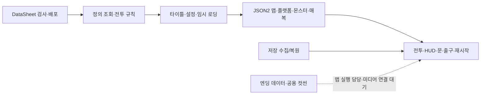
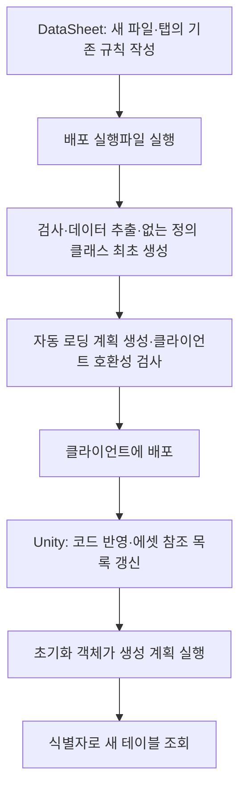
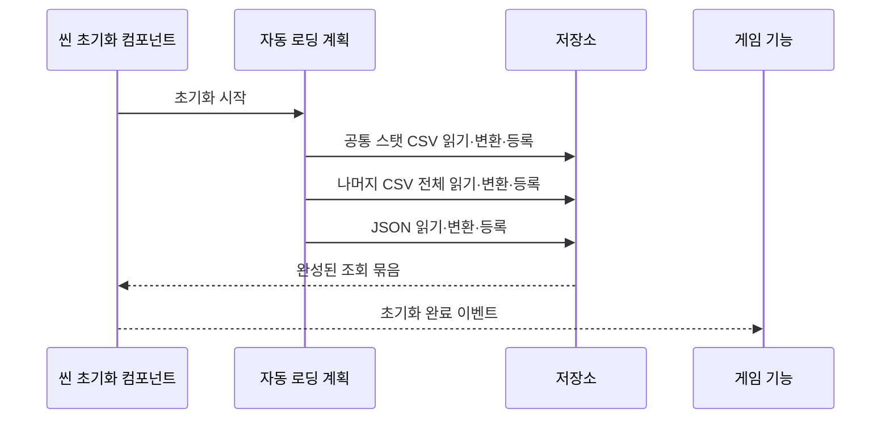

# Human_Ghost-

플레이 통계·오류는 기존 이벤트의 독립 소비자로 연결합니다. Spark 무료 구성의 Firebase 규칙과 [통계 조회 화면](https://humanghost-f85de.web.app)을 배포하고 관리자 Google 계정의 조회 권한을 등록했습니다. 원격 전송을 활성화했으므로 변경 사항을 포함한 새 게임 빌드부터 업로드합니다. 실서버 인증·문서 생성·중복 방지·익명 조회 차단은 확인했고 Unity 실제 플레이 수집은 별도 확인이 필요합니다. [연결 설계](Docs/개발자용%20설계문서/Firebase%20통계%20인증·전송·조회%20설계.md) · [조회·다운로드 안내](Docs/기획자용%20안내문서/통계%20콘솔%20조회와%20엑셀%20다운로드%20안내.md)

2026-11-12: `02d887c`로 리베이스 후 기존 작업과 스테이징을 복원했습니다. 최신 맵 PNG 467개를 재점검해 203개를 추가 압축했습니다. 기존 압축을 포함한 최신 Git 원본 대비 변경 PNG 288개의 절감량은 6,655,401 B입니다. 이미지 데이터·메타데이터 동일성과 데이터·코어 검사·엔진 참조 컴파일을 확인했습니다. [코드·리소스 전후 비교](Docs/개발자용%20설계문서/최신%20Git%20반영과%20코드·리소스%20개선%20비교.md) · [맵 확인 안내](Docs/기획자용%20안내문서/최신%20맵과%20리소스%20압축%20확인%20안내.md)

타이틀 배경 MP4는 `Assets/StreamingAssets/Video/HG_BackGround.mp4`를 원본 그대로 포함하고 파일 경로로 재생합니다. GitHub 빌드는 결과물의 영상 포함·원본 일치를 검사합니다. [영상 교체·새 빌드 확인](Docs/기획자용%20안내문서/기획자용%20타이틀%20사용%20안내.md#타이틀-배경-영상-교체와-빌드-확인--2026-11-11)을 참고합니다.

배포 검사는 과거 밸런스 수치 대신 현재 CSV·JSON의 값·참조·코드·리소스 연결을 확인합니다. [검사 설계](Docs/개발자용%20설계문서/배포%20데이터와%20기능%20연결%20검사%20설계.md) · [기획자 결과 확인](Docs/기획자용%20안내문서/배포%20검사%20결과%20확인%20안내.md)

2026-11-11: Enter 즉시 스킵 공통 입력·대상 계약을 추가했습니다. 길게 누르기는 제거했고 컷씬·영상·대사·연출 범위를 구분합니다. 새 대사는 Language ID로 연결하며 기존 임시 문구의 ID 공급은 대기입니다. [사용 안내](Docs/기획자용%20안내문서/기획자용%20즉시%20스킵%20사용%20안내.md)·[설계](Docs/개발자용%20설계문서/공용%20즉시%20스킵%20설계.md)를 참고합니다.

싱글플레이 2D 액션게임 클라이언트입니다. 자동화·모듈화·이벤트와 데이터 기반 설계를 기준으로 데이터 정의, 런타임 상태, 게임 규칙, 화면 표현, 연결과 수명을 구분합니다. 타이틀의 씬 직접 편집과 플랫폼 기준 스폰 등 승인된 방식은 유지합니다.

## 현재 프로젝트 — 2026-11-12


현재 로컬 기준은 클라이언트 7d13442·DataSheet 80bbe65입니다. 타이틀·설정·저장·처치 보상·레벨·서낭당 임시 구매 화면과 갈림길 보상 기반을 연결했습니다. 로딩 중 입력을 차단하며 일반몹 패링은 상태 확정 뒤 이벤트로 표시를 갱신합니다. 관문 표는 현재 비어 있어 미연결 표식은 경고 후 생성하지 않습니다. 갈림길 도착 영역과 대상 오브젝트, 컷씬 실행·미디어 연결, 전체 Play·빌드 검증은 남아 있습니다. 엔딩 22003과 두 재생 구간은 공급됐고, ExecuteReward·CorruptionStep은 로딩만 연결된 상태입니다.

현재 구현·검사 결과는 [현재 구현과 검증 현황](Docs/개발자용%20설계문서/현재%20구현과%20검증%20현황.md), 다음 완료 조건은 [남은 작업](Docs/개발자용%20설계문서/남은%20구현과%20검증%20작업.md), 사용법과 설계 문서의 입구는 [문서 안내](Docs/문서%20안내.md)입니다. 과거 간트 보고서는 당시 고정 기록이며 현재 플레이 완성률로 해석하지 않습니다.
## 먼저 볼 문서

타이틀과 콘텐츠 잠금은 독립 기능으로 관리합니다. 타이틀은 [설계](Docs/개발자용%20설계문서/타이틀%20설계.md)·[사용 안내](Docs/기획자용%20안내문서/기획자용%20타이틀%20사용%20안내.md), 콘텐츠 잠금은 [설계](Docs/개발자용%20설계문서/콘텐츠%20잠금%20설계.md)·[사용 안내](Docs/기획자용%20안내문서/기획자용%20콘텐츠%20잠금%20사용%20안내.md)로 나눴습니다.

실행파일은 교체용 AppIcon.png를 기본 아이콘으로 사용합니다. [이미지 교체·새 빌드 확인](Docs/기획자용%20안내문서/GitHub%20빌드와%20디스코드%20공지%20사용%20안내.md#실행파일-아이콘-교체--2026-11-09)을 따릅니다. 타이틀 메뉴는 빨간 점 대신 선택된 글자만 밝게 강조하고 다른 항목은 바랜 색으로 표시합니다.

스폰 원본·실행 참조 통합, PlayerHealthAnchor 영문 배포, 새 게임 키보드 A/B 선택 연결을 반영했습니다. [스폰 작성·배포 안내](../DataSheet/Docs/맵%20구성과%20몬스터%20배치%20데이터%20제안서.md), [키 선택 사용법](Docs/기획자용%20안내문서/기획자용%20타이틀%20사용%20안내.md#새-게임의-조작-방식-선택--2026-11-09)을 참고합니다.

GitHub에서 테스트·정식 빌드는 build_mode의 development/release로 선택합니다. 기본은 테스트이며 변경을 원격에 반영한 뒤 새 실행부터 적용됩니다. [기획자 실행 안내](Docs/기획자용%20안내문서/GitHub%20빌드와%20디스코드%20공지%20사용%20안내.md) · [개발자 빌드 선택 설계](Docs/개발자용%20설계문서/테스트와%20정식%20빌드%20선택%20설계.md)

프로젝트 설계 규칙의 목적·현재 준수 근거·승인된 예외·개선 우선순위는 [설계 기준 점검과 개선 방향](Docs/개발자용%20설계문서/설계%20기준%20점검과%20개선%20방향.md)에 모읍니다. 7개 개선의 전후 비교·책임·정수 단위·리깅 확장 계획과 실제 실행 확인 범위를 구분합니다.

서낭당 첫 접촉 저장·E키 휴식 저장과 일반 몬스터 개별 처치 기록을 현재 테스트 맵에 연결했습니다. [기획자 확인 안내](Docs/기획자용%20안내문서/서낭당%20저장과%20몬스터%20처치%20기록%20확인%20안내.md)와 [저장 설계](Docs/개발자용%20설계문서/저장%20기능%20설계.md)를 참고합니다. 실제 공간·실행파일의 왕복과 사망 검증은 남아 있습니다.

맵 출구는 일반 맵 전멸 조건을 제거하고 목적지의 콘텐츠 잠금·해금 조건을 확인하도록 변경했습니다. 장부방 8005는 실행 목록과 문 이동에 연결됐습니다. 연속 필드·별도 보스 씬과 실제 왕복·사망·완주 검증은 후속입니다. 현재 완료 경계와 다음 순서는 [현재 구현과 검증 현황](Docs/개발자용%20설계문서/현재%20구현과%20검증%20현황.md)과 [남은 작업](Docs/개발자용%20설계문서/남은%20구현과%20검증%20작업.md)을 확인합니다.

해상도와 전투 규칙을 유지한 반복 처리 개선은 [반복 갱신과 임시 표시 최적화 설계](Docs/개발자용%20설계문서/반복%20갱신과%20임시%20표시%20최적화%20설계.md)와 [확인 안내](Docs/기획자용%20안내문서/표시%20갱신%20최적화%20확인%20안내.md)를 참고합니다. PNG 무손실 압축은 반영됐지만 렌더링·최소 사양 성능 확정은 별도 측정이 필요합니다.

테스트 빌드 F12는 한 번 눌러 공용 확인 팝업을 열고, 승인하면 최신 저장 슬롯 하나만 삭제한 뒤 타이틀로 이동합니다. 설정과 다른 슬롯은 유지합니다. [기획자 사용 안내](Docs/기획자용%20안내문서/기획자용%20F12%20초기화%20사용%20안내.md) · [설계와 수명](Docs/개발자용%20설계문서/테스트%20초기화와%20공용%20확인%20팝업%20설계.md)

관문 데이터를 편집하는 기획자는 [관문 데이터 작성과 확인 안내](Docs/기획자용%20안내문서/기획자용%20관문%20데이터%20작성과%20확인%20안내.md)를 읽습니다. GateConfig의 의미부터 배포·게임 확인까지 순서대로 설명합니다.

상태와 검증 결과는 [현재 구현과 검증 현황](Docs/개발자용%20설계문서/현재%20구현과%20검증%20현황.md), 다음 작업은 [남은 구현과 검증 작업](Docs/개발자용%20설계문서/남은%20구현과%20검증%20작업.md)에서 관리합니다. 기능별 검사 숫자와 과거 임시 상태를 이곳에 중복 기록하지 않습니다.

- 컷씬: 공용 실행·역할 Key 자동 조회·인트로/장부/엔딩 호출과 잠금 정리를 준비했습니다. 실제 표·미디어·화면 배치는 대기입니다. [배치·확인 안내](Docs/기획자용%20안내문서/기획자용%20컷씬%20표시와%20씬%20이동%20안내.md)
- 사운드: 주소 준비와 동기 재생·정지 기반이 있습니다. 플레이어 동작·임시 불 환경음은 연결했고, 공급 Sound 3001~3023을 소비하며 다른 상황 조건은 후속입니다. [작성·배포 안내](Docs/기획자용%20안내문서/기획자용%20사운드%20테이블%20작성과%20배포%20안내.md), [조건 요청서](Docs/기획자용%20안내문서/기획자용%20사운드%20상황별%20재생%20조건%20요청서.md)
- 설정·오류: 타이틀/일시정지 공용 설정과 오류 모달 연결이 있습니다. 실제 화면·장치 검증은 남아 있습니다. [공통 연결·확인 안내](Docs/기획자용%20안내문서/기획자용%20공통%20모듈%20연결과%20확인%20안내.md)
- 씬 이동·저장: 현재 맵 진입은 조립/복원/최초 기록 완료를 기다리고 타이틀 복귀는 공용 암전입니다. [저장 연결 확인과 관문 ID 작성](Docs/기획자용%20안내문서/기획자용%20수동%20저장%20사용%20안내.md)을 참고합니다. 정식 공간·새 로딩 디자인은 후속입니다.

문서는 [기획자용 사용 안내 / 개발자용 설계 분류](Docs/문서%20안내.md)로 구분합니다.

Windows 게임 빌드를 버튼으로 시작하고 빌드 전용 채널에서 결과를 받는 방법은
[GitHub 빌드와 디스코드 공지 사용 안내](Docs/%EA%B8%B0%ED%9A%8D%EC%9E%90%EC%9A%A9%20%EC%95%88%EB%82%B4%EB%AC%B8%EC%84%9C/GitHub%20%EB%B9%8C%EB%93%9C%EC%99%80%20%EB%94%94%EC%8A%A4%EC%BD%94%EB%93%9C%20%EA%B3%B5%EC%A7%80%20%EC%82%AC%EC%9A%A9%20%EC%95%88%EB%82%B4.md)를 참고합니다.
현재는 수동 시작에서 테스트·정식을 선택하고 검사·빌드·결과물 7일 보관·공지가 자동 진행됩니다. 특정 커밋 입력과 매 푸시 게임 빌드는 아직 구성하지 않았습니다.

| 문서 | 내용 |
| --- | --- |
| [공용 에러 팝업 설계](Docs/%EA%B0%9C%EB%B0%9C%EC%9E%90%EC%9A%A9%20%EC%84%A4%EA%B3%84%EB%AC%B8%EC%84%9C/%EA%B3%B5%EC%9A%A9%20%EC%97%90%EB%9F%AC%20%ED%8C%9D%EC%97%85%20%EC%84%A4%EA%B3%84.md) | 표시·자동 오류 수집·공용 버튼·수명·한국어/영어 연결 계약 |
| [기획자용 에러 팝업 사용 안내](Docs/%EA%B8%B0%ED%9A%8D%EC%9E%90%EC%9A%A9%20%EC%95%88%EB%82%B4%EB%AC%B8%EC%84%9C/%EA%B8%B0%ED%9A%8D%EC%9E%90%EC%9A%A9%20%EC%97%90%EB%9F%AC%20%ED%8C%9D%EC%97%85%20%EC%82%AC%EC%9A%A9%20%EC%95%88%EB%82%B4.md) | 초보자용 씬 배치·개발자 연결 요청·외형/공용 버튼 편집·동작 확인·문제 해결 |
| [전투와 탐색 아이디어 검토안](Docs/%EA%B0%9C%EB%B0%9C%EC%9E%90%EC%9A%A9%20%EC%84%A4%EA%B3%84%EB%AC%B8%EC%84%9C/%EC%A0%84%ED%88%AC%EC%99%80%20%ED%83%90%EC%83%89%20%EC%95%84%EC%9D%B4%EB%94%94%EC%96%B4%20%EA%B2%80%ED%86%A0%EC%95%88.md) | 열한 아이디어의 의도·장르 정합성·탐색/재방문 연결·책임·검증 순서 제안 |
| [맵 구성과 몬스터 배치 데이터 제안서](../DataSheet/Docs/맵%20구성과%20몬스터%20배치%20데이터%20제안서.md) | 플랫폼 JSON에 몬스터 코드·수량 통합, 윗면 배치·풀링·처치 기록 설계안 |
| [기획자용 수동 저장 사용 안내](Docs/%EA%B8%B0%ED%9A%8D%EC%9E%90%EC%9A%A9%20%EC%95%88%EB%82%B4%EB%AC%B8%EC%84%9C/%EA%B8%B0%ED%9A%8D%EC%9E%90%EC%9A%A9%20%EC%88%98%EB%8F%99%20%EC%A0%80%EC%9E%A5%20%EC%82%AC%EC%9A%A9%20%EC%95%88%EB%82%B4.md) | F5·빈 칸·덮어쓰기·화면 편집·현재 연결 범위 |
| [저장 기능 설계](Docs/%EA%B0%9C%EB%B0%9C%EC%9E%90%EC%9A%A9%20%EC%84%A4%EA%B3%84%EB%AC%B8%EC%84%9C/%EC%A0%80%EC%9E%A5%20%EA%B8%B0%EB%8A%A5%20%EC%84%A4%EA%B3%84.md) | 슬롯 직접 선택·JSON 저장소·테스트 타이틀·독립 복원 순서·출시 제외·개발자 연결 계약 |
| [컷씬 재생 설계](Docs/%EA%B0%9C%EB%B0%9C%EC%9E%90%EC%9A%A9%20%EC%84%A4%EA%B3%84%EB%AC%B8%EC%84%9C/%EC%BB%B7%EC%94%AC%20%EC%9E%AC%EC%83%9D%20%EC%84%A4%EA%B3%84.md) | 데이터·코어·영상/그림 표시·입력·리소스 수명·실제 조립 경계 |
| [타이틀 설계](Docs/%EA%B0%9C%EB%B0%9C%EC%9E%90%EC%9A%A9%20%EC%84%A4%EA%B3%84%EB%AC%B8%EC%84%9C/%ED%83%80%EC%9D%B4%ED%8B%80%20%EC%84%A4%EA%B3%84.md) | 설계 이유·계층도·준비 순서·개발자 연결 계약·구현 경계 |
| [기획자용 타이틀 사용 안내](Docs/%EA%B8%B0%ED%9A%8D%EC%9E%90%EC%9A%A9%20%EC%95%88%EB%82%B4%EB%AC%B8%EC%84%9C/%EA%B8%B0%ED%9A%8D%EC%9E%90%EC%9A%A9%20%ED%83%80%EC%9D%B4%ED%8B%80%20%EC%82%AC%EC%9A%A9%20%EC%95%88%EB%82%B4.md) | 씬 직접 편집·이미지 교체·시연 설정 선택·검사·문제 해결 |
| [설계 기준 점검과 개선 방향](Docs/%EA%B0%9C%EB%B0%9C%EC%9E%90%EC%9A%A9%20%EC%84%A4%EA%B3%84%EB%AC%B8%EC%84%9C/%EC%84%A4%EA%B3%84%20%EA%B8%B0%EC%A4%80%20%EC%A0%90%EA%B2%80%EA%B3%BC%20%EA%B0%9C%EC%84%A0%20%EB%B0%A9%ED%96%A5.md) | 현재 설계 적합성·구현과 목표의 차이·개선 우선순위 |
| [앵커 체력 표시 테스트 안내](Docs/%EA%B8%B0%ED%9A%8D%EC%9E%90%EC%9A%A9%20%EC%95%88%EB%82%B4%EB%AC%B8%EC%84%9C/%EC%95%B5%EC%BB%A4%20%EC%B2%B4%EB%A0%A5%20%ED%91%9C%EC%8B%9C%20%ED%85%8C%EC%8A%A4%ED%8A%B8%20%EC%95%88%EB%82%B4.md) | 코드 반영·Play 실행·검사 메뉴·성공 판독·오류 전달 |
| [남은 구현과 검증 작업](Docs/%EA%B0%9C%EB%B0%9C%EC%9E%90%EC%9A%A9%20%EC%84%A4%EA%B3%84%EB%AC%B8%EC%84%9C/%EB%82%A8%EC%9D%80%20%EA%B5%AC%ED%98%84%EA%B3%BC%20%EA%B2%80%EC%A6%9D%20%EC%9E%91%EC%97%85.md) | 검사 통과 기록·다음 기능·게임 진행·보류 범위 |
| [앵커 기반 프리팹 배치 안내](Docs/%EA%B8%B0%ED%9A%8D%EC%9E%90%EC%9A%A9%20%EC%95%88%EB%82%B4%EB%AC%B8%EC%84%9C/%EC%95%B5%EC%BB%A4%20%EA%B8%B0%EB%B0%98%20%ED%94%84%EB%A6%AC%ED%8C%B9%20%EB%B0%B0%EC%B9%98%20%EC%95%88%EB%82%B4.md) | 빈 오브젝트 배치·이름 연결·부모 프리팹 생성 순서·인스턴스별 수명 |
| [체력 표시 모듈 사용과 설계 안내](Docs/%EA%B0%9C%EB%B0%9C%EC%9E%90%EC%9A%A9%20%EC%84%A4%EA%B3%84%EB%AC%B8%EC%84%9C/%EC%B2%B4%EB%A0%A5%20%ED%91%9C%EC%8B%9C%20%EB%AA%A8%EB%93%88%20%EC%82%AC%EC%9A%A9%EA%B3%BC%20%EC%84%A4%EA%B3%84%20%EC%95%88%EB%82%B4.md) | 기획자 프리팹 사용·개발자 연결·이벤트 갱신·수명 검사와 한계 |
| [데이터 기반 모듈과 화면 표현 설계안](Docs/%EA%B0%9C%EB%B0%9C%EC%9E%90%EC%9A%A9%20%EC%84%A4%EA%B3%84%EB%AC%B8%EC%84%9C/%EB%8D%B0%EC%9D%B4%ED%84%B0%20%EA%B8%B0%EB%B0%98%20%EB%AA%A8%EB%93%88%EA%B3%BC%20%ED%99%94%EB%A9%B4%20%ED%91%9C%ED%98%84%20%EC%84%A4%EA%B3%84%EC%95%88.md) | 최소 모듈·프리팹 중심 구성·데이터 연결·로드 순서·수명 계약 제안 |
| [프로젝트 기본설계](%ED%94%84%EB%A1%9C%EC%A0%9D%ED%8A%B8%20%EA%B8%B0%EB%B3%B8%EC%84%A4%EA%B3%84.md) | 객체 지향·이벤트·데이터 기반 설계 원칙과 이후 구현 범위 |
| [데이터 계층 인수인계 가이드](Docs/%EA%B0%9C%EB%B0%9C%EC%9E%90%EC%9A%A9%20%EC%84%A4%EA%B3%84%EB%AC%B8%EC%84%9C/%EB%8D%B0%EC%9D%B4%ED%84%B0%20%EA%B3%84%EC%B8%B5%20%EC%9D%B8%EC%88%98%EC%9D%B8%EA%B3%84%20%EA%B0%80%EC%9D%B4%EB%93%9C.md) | 계층도, 초기화 순서, 조회 예시, 이벤트 구독·해제, 확장 방법 |
| [게임플레이 코어](Docs/%EA%B0%9C%EB%B0%9C%EC%9E%90%EC%9A%A9%20%EC%84%A4%EA%B3%84%EB%AC%B8%EC%84%9C/%EA%B2%8C%EC%9E%84%ED%94%8C%EB%A0%88%EC%9D%B4%20%EC%BD%94%EC%96%B4%EC%99%80%20%ED%94%84%EB%A6%AC%ED%8C%B9%20%EC%97%B0%EA%B2%B0.md) | 이동·입력·콤보·자원·피격·보스 체세·프리팹 연결 |
| [임시 육안 확인](Docs/%EA%B8%B0%ED%9A%8D%EC%9E%90%EC%9A%A9%20%EC%95%88%EB%82%B4%EB%AC%B8%EC%84%9C/%EC%9E%84%EC%8B%9C%20%EA%B2%8C%EC%9E%84%ED%94%8C%EB%A0%88%EC%9D%B4%20%ED%99%95%EC%9D%B8%20%EC%95%88%EB%82%B4.md) | 사각형·텍스트로 기존 프리팹 동작 확인 |
| [일반 몬스터 AI](Docs/%EA%B0%9C%EB%B0%9C%EC%9E%90%EC%9A%A9%20%EC%84%A4%EA%B3%84%EB%AC%B8%EC%84%9C/%EC%9D%BC%EB%B0%98%20%EB%AA%AC%EC%8A%A4%ED%84%B0%20%EC%9D%B8%EA%B3%B5%EC%A7%80%EB%8A%A5.md) | 허수귀·지게귀 AI 코어·패턴 설정·관측/판정 연결 계약 |
| [검사 자동화와 오류 경계](Docs/%EA%B0%9C%EB%B0%9C%EC%9E%90%EC%9A%A9%20%EC%84%A4%EA%B3%84%EB%AC%B8%EC%84%9C/%EA%B2%80%EC%82%AC%20%EC%9E%90%EB%8F%99%ED%99%94%EC%99%80%20%EB%8D%B0%EC%9D%B4%ED%84%B0%20%EC%98%A4%EB%A5%98%20%EA%B2%BD%EA%B3%84.md) | 통합 검사·GitHub 실행·소비자 오류 분리·향후 방향과 예상 효과 |
| [기획자용 검사 사용 안내](Docs/%EA%B8%B0%ED%9A%8D%EC%9E%90%EC%9A%A9%20%EC%95%88%EB%82%B4%EB%AC%B8%EC%84%9C/%EA%B8%B0%ED%9A%8D%EC%9E%90%EC%9A%A9%20%ED%94%84%EB%A1%9C%EC%A0%9D%ED%8A%B8%20%EA%B2%80%EC%82%AC%20%EC%82%AC%EC%9A%A9%20%EC%95%88%EB%82%B4.md) | 사용 이유·준비·실행 순서·결과 확인·개발자에게 오류 전달 |
| [CSV 리더기](Docs/%EA%B0%9C%EB%B0%9C%EC%9E%90%EC%9A%A9%20%EC%84%A4%EA%B3%84%EB%AC%B8%EC%84%9C/CSV%20%EB%A6%AC%EB%8D%94%EA%B8%B0.md) | 입력 계약, 문자열 해석과 오류 전달 |
| [현재 구현과 검증 현황](Docs/%EA%B0%9C%EB%B0%9C%EC%9E%90%EC%9A%A9%20%EC%84%A4%EA%B3%84%EB%AC%B8%EC%84%9C/%ED%98%84%EC%9E%AC%20%EA%B5%AC%ED%98%84%EA%B3%BC%20%EA%B2%80%EC%A6%9D%20%ED%98%84%ED%99%A9.md) | 현재 구조 도식·이번 검사 결과·검증 한계 |
| [작업 규칙](AGENTS.md) | 명명 규칙과 책임 분리 |

## 현재 구현 범위

표시 변경 통지·상호작용 등록/해제·구독과 예약 정리는 연결했습니다. 준비 전 호출·파괴된 대상·늦은 콜백에 대한 현재 흐름은 [현재 구현과 검증 현황](Docs/개발자용%20설계문서/현재%20구현과%20검증%20현황.md#8-현재-실행과-객체-수명-도식), 구체적인 연결 계약은 [공통 모듈과 객체 수명 설계](Docs/개발자용%20설계문서/공통%20모듈과%20객체%20수명%20설계.md)를 참고합니다.



StageContentSet은 DataSheet에서 배포한 spawn/8001·8002·8003·8005.json을 참조합니다. 현재 산길 8002는 상한 9·실제 9마리, 협곡 8003은 상한 30·실제 30마리이며 협곡 중 4마리가 매복입니다. 최대 수는 JSON별 MaxMonsterCount에서 설정하고 전체 배치 합계를 배포 전에 검사합니다. 플랫폼별 Points는 FormatVersion2의 앵커 기준 좌표입니다. 맵·몬스터를 재사용하는 실제 풀은 아직 없습니다. 회피 글자는 별도 소형 풀로 재사용하며 몬스터 풀 구현과 구분합니다.

테스트·시연 수동/자동 공용10슬롯·날짜 내림차순·번호 비표시, 출시 자동1슬롯이라는 사용자 기준을 유지합니다. 현재 테스트 맵의 새 게임 최초 기록·최신/선택 기록 복원·F5·서낭당 자동 저장을 연결했습니다. 관문은 GateConfig 정수 ID로 저장합니다. 개별 처치 기록과 저장 복원은 연결했습니다. 실제 Unity 왕복·사망·저장 회귀와 연속 필드·별도 보스 씬 검증은 후속입니다.

현재 해체는 임시 900ms 대신 플레이어와 대상 애니메이션의 긴 쪽 완료 시간을 사용하며 일반몹도 기존 실행 계약을 사용합니다. 재입장/복귀·관문 우회·명중 진동·발 정렬의 최신 빌드 검증은 별도로 필요합니다. 사망 불은 설정0으로 끈 상태입니다. 회의의 시각 개선·튜토리얼·타이틀 새 시안과 실제 빌드 회귀 검사가 남았습니다. 맵19개 PC BC7은 설정 적용이며 용량·화질 측정 결과는 아닙니다.

## 프로젝트 배치와 폴더

두 저장소는 같은 부모 폴더 아래에 둡니다. 클라이언트는 Unity `6000.2.8f1`을 사용합니다. JSON 읽기는 Unity의 Newtonsoft JSON 패키지 `3.2.2`를 사용하며 에디터에서 패키지를 복원합니다.

```text
공통 부모 폴더/
├── DataSheet/
│   ├── tables/
│   └── DeployData.exe
└── Human_Ghost-/
    ├── Assets/
    │   ├── 1.Scene/                 ← Title·MapDohwagolTest·시험 씬
    │   ├── 3.Script/
    │   │   ├── Common/              ← 입력 계약·형식 읽기
    │   │   ├── Core/              ← 순수 이동·전투·몬스터 AI
    │   │   ├── Adapters/          ← 입력·초기화·설정 에셋
    │   │   ├── Preview/           ← 임시 표시·이동·판정
    │   │   ├── Presentation/      ← 체력 표시·설정 조립·구독 수명
    │   │   └── Data/
    │   │       ├── Mapping/         ← 공통 객체 변환
    │   │       ├── Storage/         ← 읽기 전용 저장소
    │   │       ├── Infrastructure/  ← 초기화·에셋 입력·수명
    │   │       └── Generated/       ← 자동 로딩 계획
    │   ├── Data/                    ← CSV·JSON·데이터 에셋 목록
    │   └── Editor/                  ← Data: 데이터 연결 / Preview: 확인용 편집기
    ├── Docs/
    └── Tools/Verify-Project.ps1
```

## 데이터 추가부터 실행까지



새 파일·탭을 추가할 때 클라이언트 초기화 목록을 수동 수정하지 않습니다. `Assets/3.Script/Data/Generated/GeneratedDataLoadPlan.cs`가 시트 규칙에서 생성됩니다. 코드와 에셋이 반영된 후 실행하면 새 테이블도 읽기·변환·저장소 등록까지 자동 연결됩니다. 이미 빌드한 실행파일에 새 타입을 추가하려면 클라이언트 재빌드가 필요합니다.

| 배포 대상 | 처리 방식 |
| --- | --- |
| CSV·JSON | 매번 갱신. 삭제한 탭의 이전 배포 데이터 정리 |
| 데이터 정의 C#·상태 열거형 | 해당 파일이 없을 때만 최초 추가. 기존 파일 보존 |
| 자동 로딩 계획 | 매번 갱신. 수동 수정 금지 |
| Unity 메타 파일 | 유지 |

기존 시트의 컬럼·생성자·상태 식별자 변경은 기존 클래스·열거형에 자동 반영되지 않습니다. 생성 파일 머리의 "다시 배포하세요" 안내만으로는 갱신되지 않으므로, 데이터 공급 담당과 스키마 변경을 맞춘 뒤 개발자가 함께 수정합니다. 자동 로딩 계획은 수동 수정하지 않습니다. 새 데이터로 실제 게임 동작을 만드는 일은 해당 기능의 구현 범위입니다.

## 초기화 순서와 사용



기본 씬의 `GameDataInitializer`가 시작 단계에서 초기화합니다. 다른 시작 씬에서는 **인귀 → 데이터 → 현재 씬에 초기화 연결**을 실행하고 씬을 저장합니다. 참조 목록 수동 갱신은 **인귀 → 데이터 → 에셋 목록 갱신**입니다.

일반 정의는 `ID`, 상태 묶음은 `UnitID`로 조회합니다. 소비자는 완료 이벤트를 구독하고, 이미 초기화된 경우 현재 `Data`를 확인하며, 비활성화 시 구독을 해제합니다. 자세한 코드는 [인수인계 가이드](Docs/%EA%B0%9C%EB%B0%9C%EC%9E%90%EC%9A%A9%20%EC%84%A4%EA%B3%84%EB%AC%B8%EC%84%9C/%EB%8D%B0%EC%9D%B4%ED%84%B0%20%EA%B3%84%EC%B8%B5%20%EC%9D%B8%EC%88%98%EC%9D%B8%EA%B3%84%20%EA%B0%80%EC%9D%B4%EB%93%9C.md)를 따릅니다. 전역 정적 저장소는 사용하지 않습니다.

데이터 정의는 읽기 전용 설정입니다. 현재 체력·위치·타이머·대상은 캐릭터 런타임이 별도로 소유합니다. 클라이언트에 배포 전 데이터 검사기를 중복 구현하지 않습니다.

## 수치·협업 원칙

기본 수치는 정수, 시간은 밀리초, 확률 분모는 10000입니다. 이동 값은 시트의 타일×100 단위를 따르고 엔진 경계에서 변환합니다. 정수 나눗셈 잔여량·반올림·범위는 각 런타임 기능에서 정의합니다. 주석·설명·로그·직접 작성한 오류 안내는 한글로 작성합니다.

공통 계약은 인터페이스로 표현하고 의존성은 명시적으로 주입합니다. 공통 스탯은 추상 기반 클래스에 한 번만 선언합니다. 상태 팩토리는 상태 구성에 사용하며 캐릭터 자체의 팩토리는 이번 설계에 두지 않습니다.

## 검증과 남은 확인

2026-11-03 전체 점검: 클라이언트 데이터875개·코어462개 통과, Unity 모듈 참조 컴파일 경고0·오류0. DataSheet EXE --check는17탭·정의21·계획1로 통과했습니다. 이번 점검에서 실제 Unity Play·최종 실행파일·GitHub 원격 실행을 재검증하지 않았습니다. 과거 Play 검사와 최신 결과는 [검증 현황](Docs/%EA%B0%9C%EB%B0%9C%EC%9E%90%EC%9A%A9%20%EC%84%A4%EA%B3%84%EB%AC%B8%EC%84%9C/%ED%98%84%EC%9E%AC%20%EA%B5%AC%ED%98%84%EA%B3%BC%20%EA%B2%80%EC%A6%9D%20%ED%98%84%ED%99%A9.md)에서 구분합니다.

```powershell
powershell.exe -NoProfile -ExecutionPolicy Bypass -File Tools/Verify-Project.ps1
```

기본 통합 검사는 .NET 10 SDK가 필요하고 Unity 설치 없이 실행합니다. `-CompileUnity`는 설치된 엔진을 참조한 컴파일을 추가합니다. Unity 위치는 `-UnityEditorPath`로 지정합니다. 임시 결과는 종료 시 정리합니다. 컴파일 통과와 프리팹 표시·실제 입력·플레이어 빌드 성공은 별도입니다.

GitHub의 Develop 푸시는 검사·개발 알림을 실행합니다. 게임 빌드는 수동 시작 후 검사·보관·별도 알림이 자동입니다. 기본 대상은 build-settings이며 활성 씬은 Title·MapDohwagolTest입니다. build_mode에서 development/release를 선택합니다. 실제 원격 두 종류 빌드와 실행파일 확인은 별도입니다.

데이터 준비 실패와 준비 완료 소비자 오류는 구분합니다. 준비된 데이터는 유지하며 초기화 완료 소비자는 개별 오류를 기록합니다. 게임플레이 결과 이벤트는 동기로 전달하고 소비자 예외를 전역에서 격리하지 않습니다. 표시 소비자는 자기 표시 오류를 자기 경계에서 정리합니다. 사용자 저장 JSON의 버전/형식 확인은 배포된 콘텐츠의 중복 검사와 다른 책임입니다.

최초 자동 로딩 전환과 도구 변경은 DataSheet 소스·EXE와 클라이언트 코드를 함께 공유합니다. 후속 순서는 [남은 작업](Docs/%EA%B0%9C%EB%B0%9C%EC%9E%90%EC%9A%A9%20%EC%84%A4%EA%B3%84%EB%AC%B8%EC%84%9C/%EB%82%A8%EC%9D%80%20%EA%B5%AC%ED%98%84%EA%B3%BC%20%EA%B2%80%EC%A6%9D%20%EC%9E%91%EC%97%85.md)을 따릅니다.
