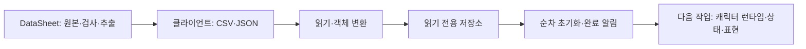
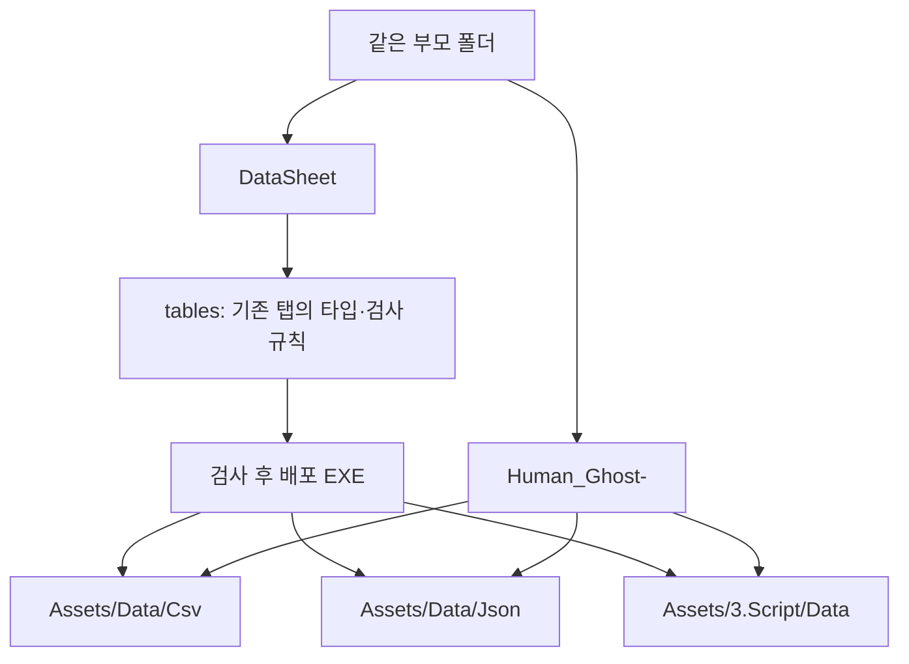
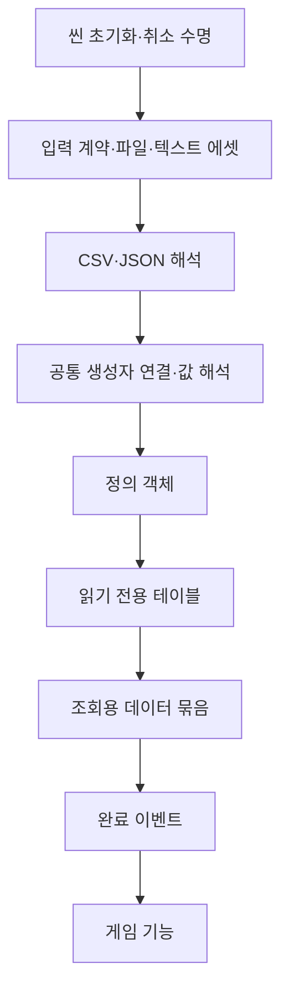
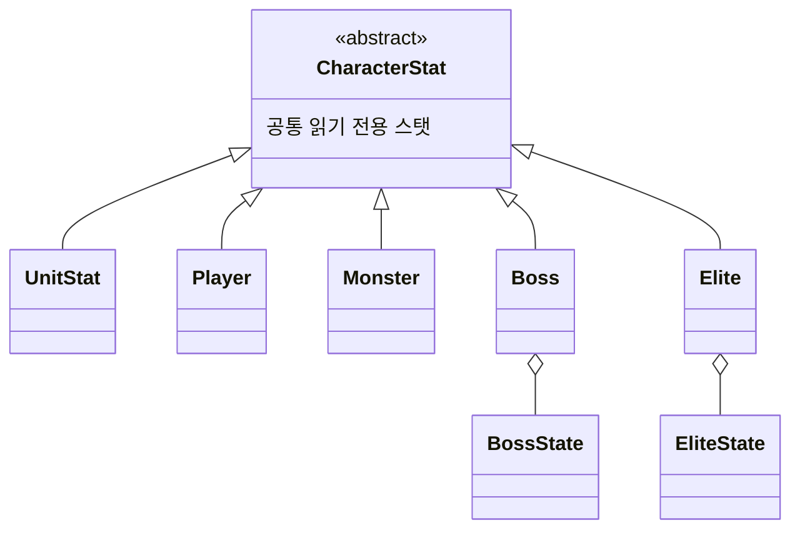

# Human_Ghost- 프로젝트 기본설계

싱글플레이 2D 액션게임입니다. 객체 지향·데이터 기반 구성·이벤트를 통한 완료 통지를 기본 원칙으로 사용합니다. 네트워크 기능은 이번 구현 범위에 포함하지 않습니다.

## 현재 구현과 작업 경계

CSV·JSON 읽기와 정의 객체 변환, 식별자 기반 저장소, 순차 초기화, 씬용 초기화 컴포넌트, 빌드용 데이터 에셋 참조 연결을 구현했습니다. 캐릭터 실행 객체·상태 머신·상태 팩토리·전투·이동·풀링은 이후 작업입니다.

다음 작업자는 [데이터 계층 인수인계 가이드](Docs/DataHandoff.md)의 계층도·사용 예시·검증 상태를 먼저 확인합니다. CSV 문법과 입력 계약은 [CSV 리더기](Docs/CsvReader.md)를 참고합니다.

## 폴더와 배포

클라이언트 스크립트 경로는 `Assets/3.Script`입니다. 데이터 정의 C#은 파일이 없을 때만 최초 추가하고 기존 파일을 덮어쓰거나 자동 삭제하지 않습니다. 별도 생성 폴더의 자동 로딩 계획은 시트 추가·삭제를 반영하도록 매번 갱신합니다. CSV·JSON은 매번 갱신합니다. 따라서 컬럼이나 State.Key를 바꾸면 기존 정의 클래스·열거형도 개발자가 수정해야 합니다.

DataSheet는 원본과 생성 코드를 관리하며 임시 추출·빌드 결과는 프로젝트에 남기지 않습니다. 배포 EXE는 기획자 실행에 필요한 도구이므로 함께 공유합니다. 데이터 검사는 DataSheet에서 수행하고 클라이언트에는 중복 검사기를 두지 않습니다.

## 데이터 계층

입력 방식은 인터페이스로 교체하고 명시적으로 주입합니다. 데이터 정의와 변환은 씬이나 게임 실행 객체를 소유하지 않습니다. 초기화 객체는 순서·저장소 구성을 조립하고 완료된 결과만 전달합니다. 전역 정적 저장소나 모든 호출을 중계하는 전역 이벤트 버스를 만들지 않습니다.

시트 규칙에서 생성한 로딩 계획으로 새 파일·탭의 읽기·변환·저장소 등록을 자동 연결합니다. 클라이언트 초기화 목록을 수동 수정하지 않습니다. 초기화는 공통 스탯 CSV, 나머지 CSV, JSON 순서입니다. 모든 단계가 성공한 뒤 조회 결과와 완료 이벤트를 공개합니다. 단계 실패·취소는 다음 단계로 진행하지 않습니다. 이벤트 소비자는 활성화·비활성화 수명에 맞춰 구독·해제합니다.

## 스탯 정의와 런타임 분리

공통 스탯은 기반 클래스에서 한 번만 선언합니다. 하위 클래스에는 고유 설정만 둡니다. BossState의 여러 페이즈는 같은 보스의 상태 배열입니다. PlayerState는 상태이상 정의이며 StateKey의 애니메이션 상태 식별자와 구분합니다.

현재 데이터 클래스는 설정 정의입니다. 현재 체력·위치·스태미나·대상·타이머는 다른 작업자가 구현할 런타임 상태가 소유합니다. 공유 정의를 게임 중 값으로 변경하지 않습니다. 캐릭터 자체의 팩토리는 두지 않고 상속된 캐릭터를 목록으로 관리하는 방향을 유지합니다.

## 정수와 단위

수치는 정수를 기본으로 사용하고 시간은 밀리초입니다. 확률의 분모는 10000이며 0 이상 10000 미만의 정수 난수와 비교합니다. 난수 공급자는 게임 규칙에 주입하고 표현용 난수와 구분합니다.

이동 거리와 속도는 현재 시트의 타일×100 단위를 따릅니다. 엔진 좌표·물리·표현 경계에서만 명시적으로 변환합니다. 시간과 이동의 정수 나눗셈 잔여량, 음수 방향, 중간 계산 범위는 런타임 구현에서 명시합니다. 정수 사용만으로 물리·실행의 결정성을 보장하지 않습니다.

치명타와 스킬 피해는 현재 시트의 정수 추가 피해인 CritDamage·Skill.Damage를 따릅니다. 확률·패럴랙스·보스 해체 피해 등 비율 항목은 지정된 만분율 의미를 유지합니다. 한 필드의 배율을 다른 필드에 임의로 적용하지 않습니다.

## 이후 게임 기능의 패턴

| 구성 | 적용할 책임 |
| --- | --- |
| 상태 패턴 | 상태 진입·진행·종료와 전환 |
| 상태 팩토리 | 캐릭터별 상태 인스턴스 구성 |
| 퍼사드 | 외부 명령을 캐릭터 기능에 전달하는 진입점 |
| 옵저버 | 피해 적용·상태 전환 등 완료된 변경 통지 |
| 추상 클래스·상속 | 실제 공통 계약과 종류별 설정 확장 |

입력·요청과 처리 결과 이벤트를 구분합니다. 상태 진행은 명시적인 갱신 흐름을 사용하며 실행 객체가 가변 상태와 구독·자원 수명을 소유합니다. 풀링은 반환·재사용 시 초기화 계약을 별도로 정의합니다. 패턴은 실제 책임에 맞춰 적용합니다.

상태의 행동 구현과 JSON의 연결 규칙, 버프 실제 효과, 스폰 JSON 생성·풀링 원본은 확정 범위에 맞춰 이후 구현합니다. 현재 예시 데이터를 완성된 동작으로 해석하지 않습니다.

## 확인 상태

개발용 검사는 실제 CSV·JSON, 공통 스탯 연결, 저장소, 초기화 순서·실패·취소를 대상으로 수행합니다. 엔진용 코드와 에디터 코드는 설치된 Unity 어셈블리 참조로 컴파일 확인합니다.

이 실행 환경에서는 Unity 일괄 실행이 라이선스 연결 시도 후 종료되어 실제 플레이·플레이어 빌드 검증은 미완료입니다. 씬과 에셋 연결은 구성했으며, 인수인계 가이드의 실행 확인 순서로 에디터·목표 플랫폼에서 마무리해야 합니다. 컴파일 확인과 실제 플레이 확인은 구분합니다.

작업은 기능 정의 → 책임 경계 → 데이터 → 상태·명령 → 결과 이벤트 → 엔진 어댑터 → 수명·성능 확인 순서로 진행합니다. 주석·설명·로그·직접 작성한 오류 안내는 한글로 작성합니다. 명명 규칙과 세부 작업 원칙은 [AGENTS.md](AGENTS.md)를 따릅니다.
